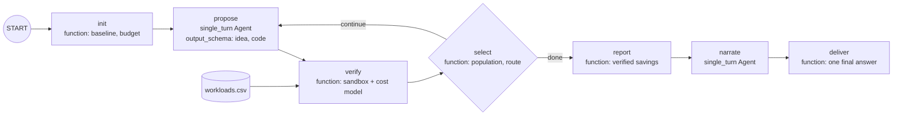

# alphaevolve-optimizer

**Cut Kubernetes node cost with an AlphaEvolve-style coding agent.**

Platform teams pay for nodes, not pods. Picking which node types to run and
how to pack pods onto them is a hard combinatorial problem, and most clusters
settle for a single default node pool. This recipe points an ADK agent at the
real decision: it **evolves a workload placement program** that fits every
pod's CPU and memory requests onto the cheapest mix of nodes.

The agent never grades its own work. It is an **ADK 2.0 graph workflow** that
runs a **propose → verify → select** loop, where only the proposal step uses
a model:

1. **Propose** – a single-turn Gemini agent writes one new placement program,
   building on the cheapest verified programs so far and the verifier's
   feedback on the last attempt.
2. **Verify** – a function node runs the program in a separate,
   resource-limited Python process against your workloads, checks every
   capacity constraint, and prices the result. Invalid plans are rejected
   with a precise reason.
3. **Select** – a function node keeps the best verified programs in ADK
   session state as parents and routes back to *propose* until the
   evaluation budget is spent or the cost reaches a proven lower bound.

The output is a report a platform team can act on: monthly cost before and
after, the recommended node mix per cluster, every idea tried with its
verified cost, and the program that produced the plan — which you can rerun
whenever workloads change.

## Architecture



| Node | Type | What it does |
| --- | --- | --- |
| `init` | function | Verifies the baseline, describes each cluster's resource shape, resets the population and sets the budget in `ctx.state`. |
| `propose` | `Agent(mode="single_turn")` | Gets a `ProposalBrief` (problem, node menu, parents with code, every idea tried, last feedback) and returns a `Candidate` (`idea`, `code`). Sees only this brief, not the chat history. |
| `verify` | function | Rejects duplicates, runs the program in the sandbox and scores it with `app/problem.py`. No model involved. |
| `select` | function | Updates the population and returns `Event(route="continue")` or `Event(route="done")`. The loop is bounded by `MAX_EVALUATIONS`. |
| `report` | function | Re-verifies the baseline and the best program and renders the Markdown report (cost table, node mix per cluster, ideas tried, best program) from verifier numbers only. |
| `narrate` | `Agent(mode="single_turn")` | Adds a short summary for the platform team and is told to quote only numbers from the report. |
| `deliver` | function | Sends the report and the summary as one final message, which is what A2A clients such as Gemini Enterprise show as the answer. |

The workflow is the `root_agent`, wrapped in `App(root_agent=..., name="app")`,
so `adk run app`, `adk web`, the FastAPI server, the A2A endpoint and the
Agent Engine adapter all serve the same graph. Every message to the agent
starts a fresh optimization run.

There is no human-approval (`RequestInput`) step: the agent only recommends a
plan and never changes a cluster, and a pause in the middle of the loop would
leave Gemini Enterprise and Chat users with a half-finished turn. Approval
belongs in your change process, after the report.

## Real-world scenario

The bundled sample (`app/data/workloads.csv`) models three production
clusters with 263 pods: an e-commerce stack (storefront, checkout, search,
recommendations), a data platform (Kafka, Spark, Trino, Airflow) and an ML
serving tier (embedding and ranking servers). They have very different
memory-to-CPU ratios, which is exactly where a single node pool wastes money.

| | Monthly cost |
| --- | --- |
| Baseline: one `std-8` node pool, first-fit | $7,238.68 |
| Proven lower bound (no plan can be cheaper) | $4,935.31 |

### Example run

One run of the workflow with `gemini-3.7-flash` and the default budget of 10
evaluations, in 8 minutes 47 seconds (every cost below was computed by the
verifier):

| Candidate | Idea proposed by the `propose` node | Verified monthly cost |
| --- | --- | --- |
| baseline | One `std-8` node pool, first-fit | $7,238.68 |
| 1 | Diverse initial packings across node types, then local search with node elimination, pod moves and swaps, downsizing every node | $6,843.02 |
| 2 | Multi-start packing across mixed node types plus 2-node joint repacking into cheaper type pairs | $6,740.82 |
| 3–6, 9 | Ratio-based segregation, multiset search, ejection chains, annealing | $6,740.82 (no gain) |
| 7, 8 | Simulated annealing; min-conflicts repair | rejected (a `NameError`; over the code-size limit) |
| 10 | Fix ratio alignment so `highcpu` nodes get the lowest memory/CPU pods first | **$6,689.72** |

Result: **$548.96/month saved (7.6%)** across the three clusters, by moving
from 37 `std-8` nodes to a per-cluster mix: `ecommerce-prod` on 2
`highcpu-16`, 1 `highcpu-8` and 3 `std-16`; `data-platform` on 6 `std-16` and
1 `std-4`; `ml-serving` on 6 `std-16`. The two rejected candidates cost an
evaluation each but never reached the report. Results vary between runs
because proposals come from a model.

The node menu and prices in [`app/problem.py`](app/problem.py) are
**illustrative**; replace them with your own node types and negotiated rates.

### Use your own workloads

Point `WORKLOADS_CSV` at a CSV of your pods' resource requests:

```csv
cluster,workload,replicas,cpu_millicores,memory_mib
checkout-prod,payments-api,6,1000,1024
```

You can build it from `kubectl get deployments -A -o json` (container
`resources.requests` times `spec.replicas`) or from your cost-allocation
export. Each `cluster` value becomes one benchmark instance.

## What you will learn

- Building an **ADK 2.0 graph workflow** (`google.adk.Workflow`) that mixes
  deterministic function nodes with single-turn `Agent` nodes.
- Bounding an LLM loop with **conditional routing**
  (`Event(route="continue" | "done")` and a routing-map edge) instead of
  trusting the model to stop.
- Passing structured data between nodes with Pydantic **`input_schema` /
  `output_schema`**, and keeping the population in **`ctx.state`**.
- Grounding an LLM in a **deterministic verifier** so every claimed saving is
  measured, not asserted.
- Running untrusted, model-written code with **process isolation**, timeouts
  and resource limits, and scoring it outside the child process.

## Requirements

Before you begin, ensure you have:
- **uv**: Python package manager - [Install](https://docs.astral.sh/uv/getting-started/installation/)
- Access to Gemini through Vertex AI or a Google AI Studio API key.

## Setup

> **Note**: All commands below must be run from the recipe root directory (`contrib/python/alphaevolve-optimizer/`).

1. Install required packages:
   ```bash
   uv sync
   ```

2. Set up environment variables. Copy `.env.example` to `.env` and configure
   either Vertex AI (`GOOGLE_CLOUD_PROJECT`, `GOOGLE_GENAI_USE_VERTEXAI=True`)
   or `GEMINI_API_KEY`:
   ```bash
   cp .env.example .env
   ```

   | Variable | Default | Purpose |
   | --- | --- | --- |
   | `MODEL_NAME` | `gemini-3.7-flash` | Model behind the `propose` and `narrate` nodes |
   | `WORKLOADS_CSV` | bundled sample | Your pods' resource requests |
   | `MAX_EVALUATIONS` | `10` | Verified evaluations (proposals) per run |
   | `POPULATION_SIZE` | `4` | Best programs kept as parents |
   | `CANDIDATE_TIMEOUT_SECONDS` | `10` | Wall-clock and CPU limit per evaluation |

## Run

Start the agent in the terminal and ask it to cut cost. Every message starts
a new run; progress is printed after each verified candidate:

```bash
uv run adk run app
# > Find the cheapest node plan for my clusters.
```

Or start the local web server and open the ADK dev UI:

```bash
uv run uvicorn app.fast_api_app:app --reload
```

Each proposal is one model call that writes a full program, typically 1–2
minutes with `gemini-3.7-flash`, so a default run of 10 evaluations takes
about 15–20 minutes. Lower `MAX_EVALUATIONS` for a quick look.

## Deploy and use it in Gemini Enterprise

The recipe ships a `Dockerfile` and serves the standard ADK FastAPI app, with
an [A2A](https://a2a-protocol.org/) endpoint for the workflow at `/a2a/app`.
Deploy it to Cloud Run:

```bash
gcloud run deploy alphaevolve-optimizer --source . --region us-central1 \
  --set-env-vars MODEL_NAME=gemini-3.7-flash,GOOGLE_GENAI_USE_VERTEXAI=True
```

Then set `APP_URL` to the service URL (for example with
`gcloud run services update alphaevolve-optimizer --update-env-vars APP_URL=https://...`)
so the agent card advertises the public endpoint. The card is served at:

```text
https://<your-service-url>/a2a/app/.well-known/agent-card.json
```

It lists a JSON-RPC interface with protocol version `0.3` next to `1.0`,
which is the shape Gemini Enterprise expects. Register the agent in your
Gemini Enterprise app as a custom A2A agent with this card by following
[Register and manage A2A agents](https://cloud.google.com/gemini/enterprise/docs/register-and-manage-an-a2a-agent).
To reach it from a Chat space, follow
[Build a Google Chat app with a Gemini Enterprise AI agent](https://developers.google.com/workspace/chat/quickstart-ge-agent).
Engineers can then ask for a fresh cost plan whenever workloads change, and
the answer arrives as one message with the tables, the summary and the
program.

The container also serves the Agent Engine `:query` / `:streamQuery` routes
(`app/app_utils/reasoning_engine_adapter.py`) if you deploy it to Agent
Engine with a container spec instead.

What was verified locally (no Gemini Enterprise app or GCP project): the
agent card's `0.3` JSON-RPC interface, URL, name, description and skills; a
full A2A `message/send` round trip that returns the verified report; and the
Agent Engine adapter route. `tests/integration/test_server_e2e.py` repeats
these checks.

## Use it for other problems

Everything problem-specific lives in [`app/problem.py`](app/problem.py):
`PROBLEM_STATEMENT`, `ENTRY_POINT`, `INSTANCES`, `BASELINE_PROGRAM`,
`lower_bound()` and `score_outputs()`. Replace them to evolve another
program with a measurable objective, such as a job scheduler, a routing
heuristic or a cache eviction policy. The workflow, sandbox and selection
logic stay the same.

## Safety

The verifier isolates candidates in a separate interpreter (`python -I -B`)
with an empty environment, a timeout, and CPU, memory and file-write limits.
This is **process isolation, not a security sandbox**. Run the recipe in its
container and add a stronger sandbox (for example gVisor) before exposing it
to untrusted users. Every number in the report comes from the verifier, and
the `narrate` node is told to quote only those numbers. The agent only
recommends a plan; it never changes your clusters.

## Running Tests

The unit tests cover the cost model, the verifier, the selection logic, each
function node, and the routing of the whole graph with stub `propose` and
`narrate` nodes. They do not call a model:

```bash
uv run pytest
```

Integration tests call Gemini and need credentials. They run the workflow
end to end and check the A2A agent card, an A2A `message/send` round trip
and the Agent Engine adapter against a local server:

```bash
uv run pytest tests/integration
```

## Commands

| Command | Description |
| ------- | ----------- |
| `uv run adk run app` | Run the workflow in interactive CLI mode |
| `uv run uvicorn app.fast_api_app:app --reload` | Start the local FastAPI development server (ADK dev UI, A2A) |
| `uv run pytest` | Run the unit and runnability tests |
| `uv run pytest tests/integration` | Run the live end-to-end and A2A tests |
