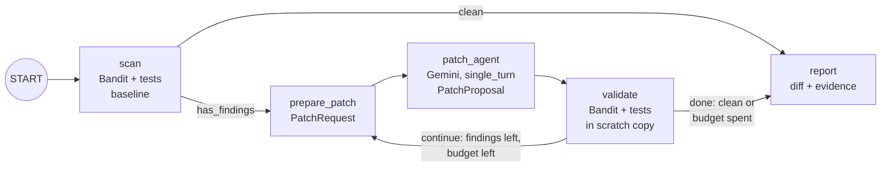

# codemender-security-fixer

**Work down an AppSec finding backlog with a CodeMender-style agent.**

Security scanners are good at producing findings and bad at closing them.
AppSec and platform teams end up with a backlog of SQL injections, unsafe
deserialization and shell injections that every service team has to triage
and fix by hand. This recipe points an ADK agent at that backlog and has it
**propose fixes that a deterministic validator must accept** before anyone
sees them, in the spirit of
[CodeMender](https://deepmind.google/blog/introducing-codemender-an-ai-agent-for-code-security/).

The agent never grades its own work. It is an **ADK 2.0 graph workflow**
(`google.adk.Workflow`) in which only one node calls a model:

1. **`scan`** (function node) copies the target to a throwaway working copy
   and records the baseline: [Bandit](https://bandit.readthedocs.io/) plus
   the project's own tests. Failing exploit tests are findings too, so
   issues a static analyzer cannot see (such as path traversal) are covered.
   Routes to `prepare_patch` if anything is open, otherwise straight to
   `report`.
2. **`prepare_patch`** (function node) packs the open findings, the source
   files, the failing tests and the reason the last proposal was rejected
   into a typed `PatchRequest`.
3. **`patch_agent`** (`Agent`, `mode="single_turn"`) reads the
   `PatchRequest` and returns one structured `PatchProposal`: file, complete
   new content and rationale. It has no tools and no file system access.
4. **`validate`** (function node) applies the proposal to a scratch copy and
   re-runs Bandit and every test in a resource-limited subprocess. The patch
   is kept only if it **resolves at least one finding, introduces no new
   Bandit finding and breaks no passing test**. Edits to tests and
   `# nosec` suppressions are refused. Routes back to `prepare_patch` (with
   the rejection reason as feedback) while findings remain and the
   `MAX_PATCH_ATTEMPTS` budget lasts, otherwise to `report`.
5. **`report`** (function node) produces the unified diff and the evidence.

The output is a **unified diff plus evidence** for human review: which
findings were fixed, which exploit tests now pass, test results before and
after, and every attempt with its verdict. Nothing is committed or pushed.



Each user message starts a fresh run, so the same agent works from the ADK
dev UI, `adk run`, A2A clients and Gemini Enterprise. There is no
`RequestInput` approval step: the workflow never applies anything, so the
human approval happens where it belongs, in code review of the diff. A
pause-and-resume step would also leave A2A / Gemini Enterprise chats waiting
on an input most clients cannot send.

## Real-world scenario

The bundled target ([`app/sample_target/`](app/sample_target/)) is a small
internal **orders API** (stdlib `http.server` + SQLite) of the kind every
company has: list a customer's orders, download invoices, archive a month of
invoices for finance, restore a shopping cart from a cookie, protect admin
endpoints with a bearer token. It ships five realistic vulnerabilities and
the tests an AppSec reviewer would write for them:

| Vulnerability | Where | Bandit | Exploit test |
| --- | --- | --- | --- |
| SQL injection (f-string query) | `orders/db.py` | B608 | 3 tests |
| Path traversal in invoice download | `orders/invoices.py` | — | 1 test, 4 payloads |
| Command injection (`shell=True`) | `orders/invoices.py` | B602 | 1 test |
| Unsafe deserialization (pickle cookie) | `orders/cart.py` | B301, B403 | 1 test |
| Hardcoded admin token | `orders/auth.py` | B105 | 2 tests |

Before the agent runs: **5 Bandit findings, 9/17 tests passing** (all 9
functional tests pass, all 8 exploit tests fail). What the AppSec team gets
back is a patch that closes every finding with evidence attached, ready for a
normal code review.

> [!WARNING]
> `app/sample_target/` is intentionally vulnerable. Never deploy it or copy
> its patterns. Its lines carry `# noqa` markers only so the repository's own
> linter accepts the sample; Bandit still reports them.

### Example run

One live run of the workflow against the bundled target with
`MODEL_NAME=gemini-3.7-flash` and the default budget of 8 patch attempts:

| Metric | Result |
| --- | --- |
| Bandit findings | 5 → **0** (B105, B301, B403, B602, B608) |
| Tests passing | 9/17 → **17/17** (all 8 exploit tests fixed, no regressions) |
| Files patched | 4 (`invoices.py`, `db.py`, `cart.py`, `auth.py`) |
| Patch attempts | 4 of 8, all accepted by the validator |
| Model calls | 4 (one `patch_agent` call per attempt) |
| Wall-clock time | 99.0 s, including every Bandit and test run |
| Tokens | 21.8k prompt, 2.0k output |

The first patch fixed path traversal and shell injection together in
`invoices.py` (real-path containment check, `YYYY-MM` validation, argv list
without a shell); the others parameterized both SQL filters, replaced the
pickle cookie with JSON and moved the admin token to `ORDERS_API_TOKEN`,
failing closed when it is unset. Because only one small, schema-constrained
model call happens per attempt and Bandit and the tests run in plain Python,
the graph used about 8x fewer prompt tokens than an earlier tool-calling
version of this recipe on the same task (178.9k). Numbers vary between runs,
and passing the validator is not the same as being correct: review the diff.

### Use your own repository

Point `TARGET_DIR` at a Python project. It is copied to a temporary working
directory (without `.git`, virtualenvs or `.env`) and never modified:

```bash
TARGET_DIR=/path/to/payments-service \
TEST_COMMAND="python -m pytest -rA -q" \
uv run adk run app
```

- With no `TEST_COMMAND`, stdlib `unittest` tests under `tests/` are
  discovered and reported per test. For pytest, pass `-rA` so per-test
  results are visible; otherwise only the exit code is used.
- The tests run with this recipe's interpreter, so your project's test
  dependencies must be installed there (for example `uv add --dev pytest`).
- Add exploit tests for the findings you care about. They are what turns
  "Bandit is quiet" into "the attack no longer works".
- Files under `tests/`, `test_*.py`, `*_test.py` and `conftest.py` are
  evidence: the agent can read them but cannot change them.

## What you will learn

- Gating every model-written change with a **deterministic validator** that
  compares scanner and test results before and after, so the model cannot
  talk its way past a failing test.
- Building an **ADK 2.0 graph workflow**: function nodes for deterministic
  steps, a `single_turn` `Agent` with Pydantic `input_schema` /
  `output_schema` for the one creative step, and conditional routing
  (`Event(route=...)`) for a bounded retry loop.
- Keeping the working copy, baseline, accepted patches and attempt budget in
  ADK session state (`ctx.state`), reproducible on any server instance.
- Serving the same workflow over **A2A**, so it can be registered in Gemini
  Enterprise.
- Running untrusted project code with **process isolation**, timeouts,
  resource limits and an environment stripped of credentials.

## Requirements

Before you begin, ensure you have:
- **uv**: Python package manager - [Install](https://docs.astral.sh/uv/getting-started/installation/)
- Access to Gemini through Vertex AI or a Google AI Studio API key.
- `tar` on the `PATH` (used by the sample target's archive endpoint).

## Setup

> **Note**: All commands below must be run from the recipe root directory (`contrib/python/codemender-security-fixer/`).

1. Install required packages (this includes Bandit):
   ```bash
   uv sync
   ```

2. Set up environment variables. Copy `.env.example` to `.env` and configure
   either Vertex AI (`GOOGLE_CLOUD_PROJECT`, `GOOGLE_GENAI_USE_VERTEXAI=True`)
   or `GEMINI_API_KEY`:
   ```bash
   cp .env.example .env
   ```

   | Variable | Default | Purpose |
   | --- | --- | --- |
   | `MODEL_NAME` | `gemini-3.7-flash` | Model that writes the patches |
   | `TARGET_DIR` | bundled sample | Repository to fix (copied, never modified) |
   | `TEST_COMMAND` | `unittest` discovery | Test command (no shell) |
   | `BANDIT_SKIPS` | `B101,B404,B603,B607` | Bandit checks that flag usage, not vulnerabilities |
   | `MAX_PATCH_ATTEMPTS` | `8` | Validator calls allowed per session |
   | `VALIDATION_TIMEOUT_SECONDS` | `120` | Wall-clock and CPU limit per scan or test run |

## Run

Start the agent in the terminal and ask it to fix the backlog:

```bash
uv run adk run app
# > Fix the security findings in the orders service and give me a reviewable patch.
```

Or start the local web server and open the ADK dev UI:

```bash
uv run uvicorn app.fast_api_app:app --reload
```

The final report includes the diff, and the `report` node also writes it to
a `codemender.patch` file next to the working copy. Apply it to a branch of
your repository with `git apply codemender.patch` and open a normal code
review. Working copies live under the system temp directory
(`codemender-work-*`) and are left in place so you can inspect them; delete
them when you are done.

## Deploy and use it where your team works

The recipe ships a `Dockerfile` (non-root user, Bandit installed) that serves
the standard ADK FastAPI app plus two integration surfaces from
[`app/fast_api_app.py`](app/fast_api_app.py):

- **A2A** (`app/app_utils/a2a.py`): JSON-RPC at `/a2a/app` and the agent
  card at `/a2a/app/.well-known/agent-card.json`. The card advertises a
  JSON-RPC interface for A2A 1.0 and the 0.3 shape (top-level `url`,
  `protocolVersion: "0.3"`) that Gemini Enterprise registration expects.
- **Agent Engine** (`app/app_utils/reasoning_engine_adapter.py`):
  `POST /api/reasoning_engine` and `/api/stream_reasoning_engine`, the
  routes Agent Engine forwards `:query` and `:streamQuery` to.

To make it available in Gemini Enterprise:

1. Deploy it, for example to Cloud Run:
   ```bash
   gcloud run deploy codemender-security-fixer --source . --region us-central1 \
     --no-allow-unauthenticated \
     --set-env-vars MODEL_NAME=gemini-3.7-flash,GOOGLE_GENAI_USE_VERTEXAI=True,APP_URL=https://YOUR-SERVICE-URL
   ```
   Set `APP_URL` to the service URL so the agent card points at it.
2. Check `https://YOUR-SERVICE-URL/a2a/app/.well-known/agent-card.json`.
3. Register it as a custom A2A agent in your Gemini Enterprise app with that
   agent card, following
   [Register and manage A2A agents](https://cloud.google.com/gemini/enterprise/docs/register-and-manage-an-a2a-agent).
4. Optionally expose it in Google Chat with
   [Build a Google Chat app with a Gemini Enterprise AI agent](https://developers.google.com/workspace/chat/quickstart-ge-agent).

Engineers then ask for a validated patch from Gemini Enterprise or a Chat
space; each message runs the workflow once and returns the report and diff.
To fix your own code in Cloud Run, bake the repository into the image (or
mount it) and set `TARGET_DIR`. Keep the service private: it executes the
target's tests.

What was verified locally (no GCP project or Gemini Enterprise app was
available): the served agent card has the 0.3 fields above, a JSON-RPC
`message/send` with `A2A-Version: 0.3` runs the whole workflow and returns
the report and diff as a completed task, and the Agent Engine adapter
creates sessions and starts the workflow. Agent Engine's runtime switches the
model client to Vertex AI, so a full run through the adapter needs Vertex AI
credentials; with only an API key locally, the run stops at the first model
call. [`tests/integration/test_a2a.py`](tests/integration/test_a2a.py)
repeats the card and `message/send` checks.

## Safety

- **Process isolation, not a sandbox.** Bandit and the target's tests run in
  a separate interpreter with a minimal environment (no API keys or cloud
  credentials), a timeout, and CPU, memory and file-size limits, inside a
  disposable copy. The tests are still arbitrary code with network and file
  system access. Run the recipe in its container and add a stronger sandbox
  (for example gVisor) before pointing it at code you do not trust.
- **The target is never modified.** All edits happen in a temporary working
  copy; validation happens in a second, scratch copy.
- **The agent never commits or pushes.** It has no git or network tools. Its
  only output is a diff and a report.
- **Human review is required.** Passing Bandit and the tests is necessary,
  not sufficient: tests can miss attack variants and Bandit has false
  negatives. Review every patch like any other change before merging.

## Running Tests

The unit tests cover the scanner and test harness, the validator (accepting
a correct fix, rejecting a broken one and an incomplete one, prechecks), each
deterministic workflow step, the attempt budget, `TARGET_DIR` handling and
report generation. They also run the real ADK 2.0 graph end to end with the
Gemini node swapped for a scripted function node, so routing (retry after a
rejection, stop when clean, stop when the budget is spent) is tested. They
run Bandit and the sample's tests for real and do not call a model:

```bash
uv run pytest
```

Integration tests call Gemini and need credentials. `test_a2a.py` starts the
server, checks the agent card and runs the workflow over A2A `message/send`:

```bash
uv run pytest tests/integration
```

## Commands

| Command | Description |
| ------- | ----------- |
| `uv run adk run app` | Run the agent in interactive CLI mode |
| `uv run uvicorn app.fast_api_app:app --reload` | Start the local FastAPI development server |
| `uv run pytest` | Run the unit and runnability tests |
