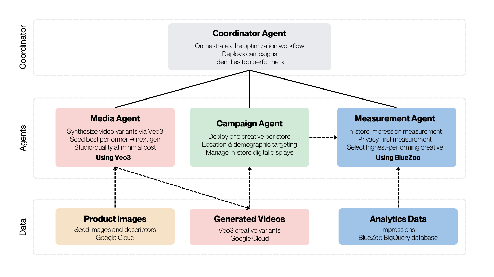
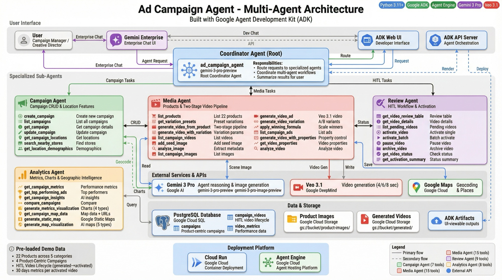

# Video Ad Optimization Agent (react-ad-flow)

A privacy-first audience measurement and generative AI agent system for optimizing in-store digital video advertising at point of sale.

Developed to demonstrate how Google's generative media technologies (Veo 3.1 and Gemini Image models) combine with real-time audience analytics (such as BlueZoo sensor data) to establish a continuous, data-driven creative optimization loop.

<p align="center">
  
</p>

## Overview

Traditional in-store advertising campaigns require substantial creative resources, production cycles, and costs. Determining which advertisement drives the best sales lift has historically relied on manual guesswork.

This recipe showcases an automated multi-agent system:
1. **Coordinator Agent (`root_agent`)**: Orchestrates the workflow across specialized sub-agents.
2. **Campaign Agent**: Manages campaign creation, store locations, and metadata.
3. **Media Agent**: Handles seed images, prompt composition, and video generation using Google Veo 3.1 and Gemini image models.
4. **Review Agent**: Activates candidate videos, manages human-in-the-loop review, and supports Omni Flash video edits.
5. **Analytics Agent**: Computes revenue per impression (RPI), correlates point-of-sale (POS) revenue with sensor dwell times, and generates comparison charts and map visualizations.

<p align="center">
  
</p>

## Prerequisites

- **Python**: `>=3.11,<3.14`
- **uv**: Python package and project manager — [Install guide](https://docs.astral.sh/uv/getting-started/installation/)
- **Google Cloud Project**: Vertex AI enabled with Gemini and Veo model access

## Quick Start

> **Note**: All commands below should be executed from the recipe directory (`contrib/python/react-ad-flow/`).

1. **Install dependencies**:
   ```bash
   uv sync
   ```

2. **Configure environment variables**:
   Copy `.env.example` to `.env` and configure your credentials:
   ```bash
   cp .env.example .env
   ```
   Set at minimum:
   - `GOOGLE_CLOUD_PROJECT`
   - `GOOGLE_API_KEY` (or authenticate via Application Default Credentials)
   - `AGENT_MODEL` (default: `gemini-3.7-flash`)

3. **Run the agent interactively**:
   ```bash
   uv run adk run app
   ```

4. **Start the local FastAPI serving web server**:
   ```bash
   uv run uvicorn app.fast_api_app:app --host 0.0.0.0 --port 8000
   ```

## Running Tests

To run the complete test suite (unit and runnability tests):
```bash
uv run pytest
```

To run only the unit test suite:
```bash
uv run pytest tests/unit
```

To run the runnability verification test:
```bash
uv run pytest tests/test_runnability.py
```

## Architecture & Workflows

### Multi-Agent Flow
1. **Browse Products**: Browse retail catalog items.
2. **Create Campaign**: Configure store location, target demographic, and campaign parameters.
3. **Generate Video Ad**: Generate candidate video creatives with Veo 3.1.
4. **Activate & Review**: Approve and schedule video for in-store screen playback.
5. **Analyze Performance**: Compute impressions, dwell time, and Revenue Per Impression (RPI).

<p align="center">
  
</p>
